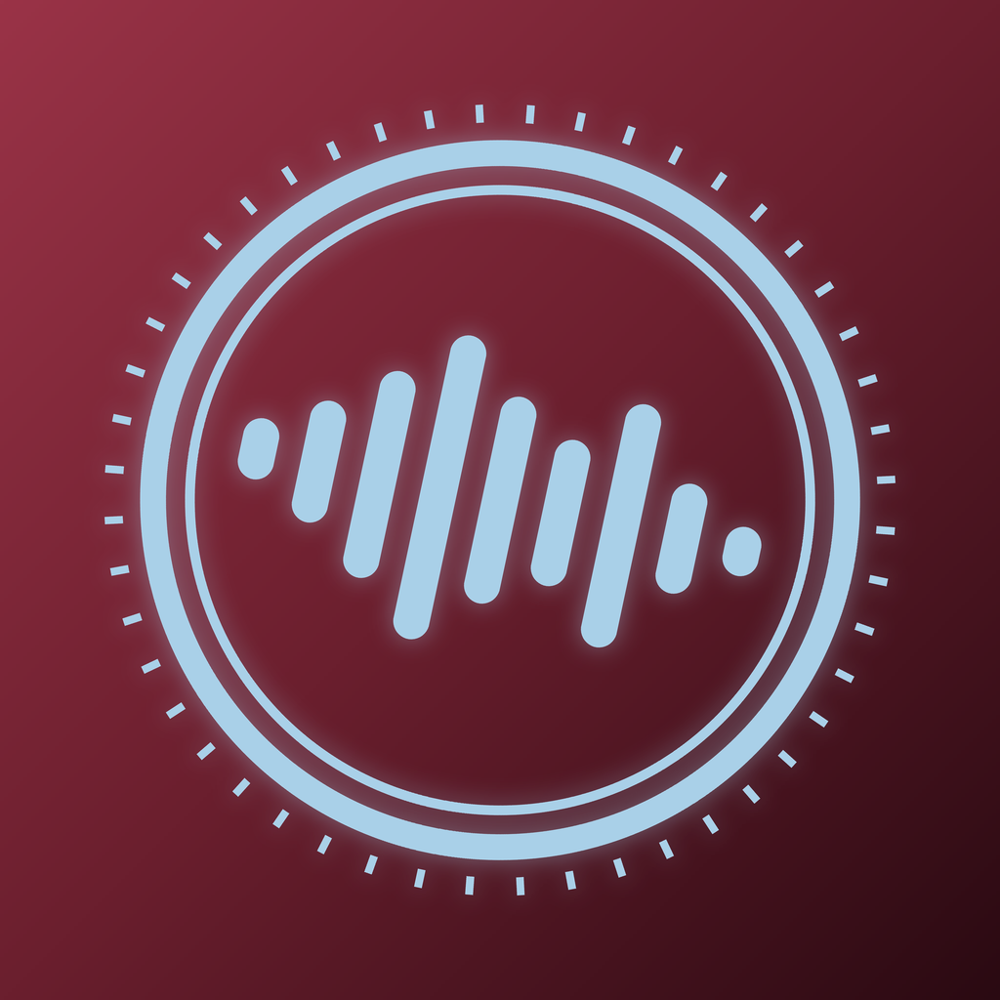

<p align="center"></p>

# VoiceInvoice PRO

Hands-free invoicing for small merchants on iPhone and iPad. Dictate line items, get a finished invoice with your stamp and signature, share it as a PDF.

- [Summary](VoiceInvoice_Project_Summary.md)
- [Full v1 specification](VoiceInvoice_Complete_Project_Total_Specifications.md)
- [Privacy policy (draft)](PRIVACY.md)
- [Apple setup guide](docs/APPLE_SETUP.md)
- [Test checklist](docs/TEST_CHECKLIST.md)

## What works

| Area | Status |
|---|---|
| Invoices, recent-customer reuse, tax, discount, numbering, PDF export and share | Built, unit-tested |
| Shop profile, logo, signature (PencilKit), stamp scanning (camera, transparent PNG, clean-up slider) | Built, unit-tested |
| Dictation and line-item parsing: English, French, Spanish, Italian, Simplified Chinese | Built, unit-tested on written phrases |
| Freemium paywall: 5 free invoices a month, Pro monthly and yearly (StoreKit 2) | Built, needs App Store Connect products |
| Siri ("New invoice in VoiceInvoice"), Home/Lock Screen widget, Control Center control and Action Button | Built, needs a real device |
| Voice profiles: enrollment with consent, up to 3 voices, speaker identification, per-line attribution | Built (lightweight on-device model), needs real-voice testing |
| Localization: UI, PDF labels, permission prompts in 5 languages | Built (machine-written translations, review before release) |

## Known limits

- **Speaker identification** uses a small MFCC-based model, tested on synthetic voices only. It identifies who started a dictation; it does not separate overlapping speakers or gate the transcript by voice, and there is no always-on wake-phrase mode. Accuracy in noisy shops is unmeasured. It is a convenience label, not security.
- **Siri phrases** are localized in an App Shortcuts catalog, but that format is unverified on a real device.
- **Apple Intelligence** only assists when the rule-based parser could not read a price, and only on supported devices. It is compiled with Xcode 26 but cannot be exercised in CI.
- **Widgets and controls** need iOS 18. The app itself runs on iOS 17.
- Translations were written by an AI and should be reviewed by native speakers.

## Build

The Xcode project is generated from `project.yml` with [XcodeGen](https://github.com/yonaskolb/XcodeGen).

```bash
brew install xcodegen
xcodegen generate
open VoiceInvoice.xcodeproj
```

GitHub Actions (`.github/workflows/ios.yml`) builds and runs the unit tests on every push.

String catalogs are generated from `tools/translations.txt`:

```bash
python tools/build_catalogs.py
```

## Releasing

Step-by-step Apple and Codemagic setup (App Group, iCloud container, App IDs, subscriptions, signing, first development build, TestFlight) is in [docs/APPLE_SETUP.md](docs/APPLE_SETUP.md). What to test is in [docs/TEST_CHECKLIST.md](docs/TEST_CHECKLIST.md).

`codemagic.yaml` has two manual workflows: `ios-development` (install on your own iPhone and create the iCloud schema) and `ios-testflight`.
